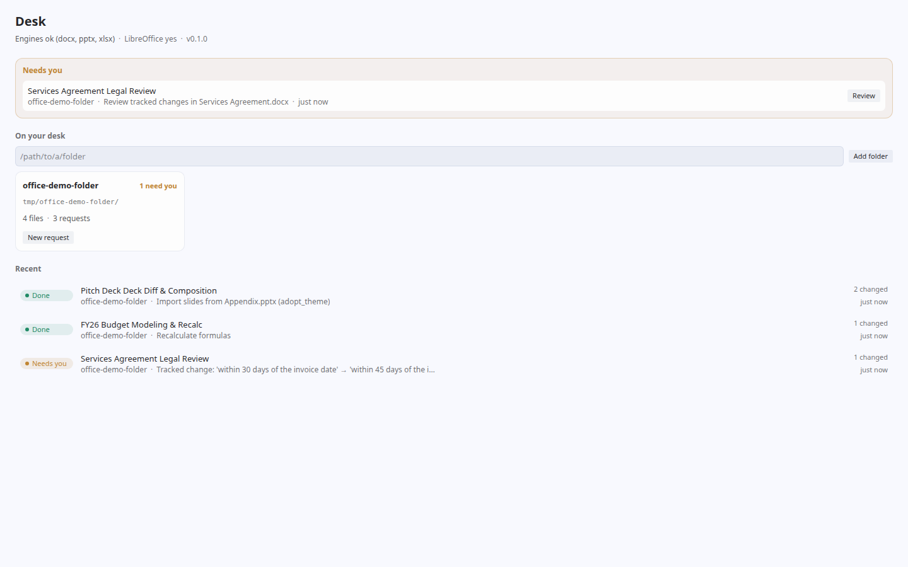
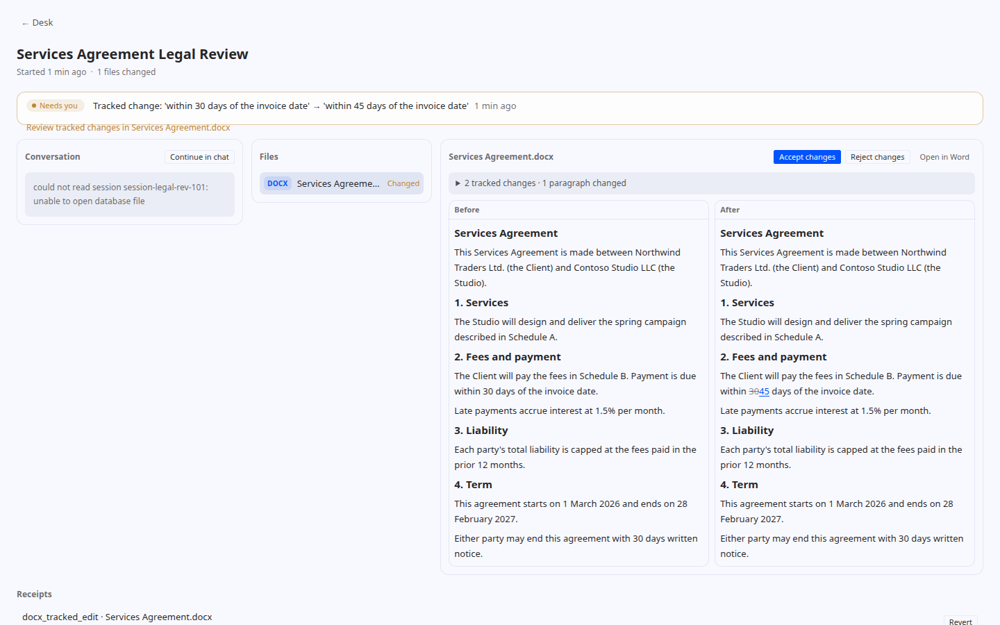
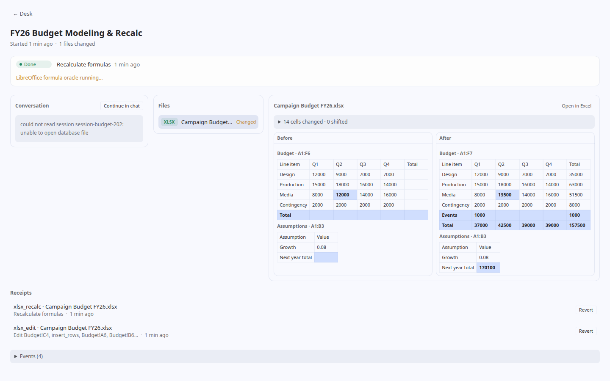

# hermes-office

[](https://github.com/DECRUX9812/hermes-office/actions/workflows/ci.yml)
[](LICENSE)

A [Hermes](https://github.com/NousResearch/hermes-agent) plugin for **safely editing Word, PowerPoint and
Excel files**. It gives the agent 14 guarded tools built on Paper Instruments'
[paper-docx](https://github.com/paper-instruments/paper-docx),
[paper-pptx](https://github.com/paper-instruments/paper-pptx) and
[paper-xlsx](https://github.com/paper-instruments/paper-xlsx). Those libraries give you tracked changes,
format-preserving edits and honest refusals, so nothing gets done by raw XML surgery. You also get a **Desk** page
where you watch the work and control it: folders, workstreams, before/after previews, diffs, accept/reject and revert.



## Why it is safe

- **Edits stay inside your Desk folders.** The agent can only *edit* files inside a folder you put on the Desk.
  Anything else is refused with `outside_desk`. It can still *read* any readable file.
- **Every change gets a receipt.** A receipt holds the before/after sha256, a byte-exact backup and the library's own
  report. `office_receipt action=revert` restores the backup.
- **Writes are atomic and narrow.** Each write goes to a temp file and is then renamed into place. `patch_save` and
  the preserve-mode saves leave every untouched part byte-identical.
- **A refusal leaves the file byte-identical.** Refusals come back as
  `{"ok": false, "refused": true, "reason", "message", "hint"}`.
- **Word edits wait for you.** Edits are made as tracked changes, which you accept or reject in Word or on the
  Desk. Tracked changes and refused edits flag the workstream as **Needs you**.
- **LibreOffice is only used for formula caches.** It recalculates Excel formula caches into a candidate file,
  and that candidate is checked before it replaces the original.

## Install

hermes-office needs Python ≥ 3.11 and must be installed in the **same Python environment as Hermes**.

```bash
# 1. The Paper Instruments libraries (they provide the `docx`, `pptx` and `openpyxl` import names)
pip install paper-docx paper-pptx paper-xlsx

# 2. The plugin
pip install git+https://github.com/DECRUX9812/hermes-office.git@v0.1.0
```

> [!WARNING]
> **Never install the Paper libraries next to `python-docx`, `python-pptx` or `openpyxl` in the same environment.**
> The Paper forks *replace* those packages and use the same import names. If both are installed, one overwrites the
> other and you get the wrong engine without any error. If a stock package is already there, uninstall it first
> (`pip uninstall python-docx python-pptx openpyxl`), or use a dedicated venv. If the forks are not the ones being
> imported, the tools report themselves as unavailable.

Optional: install [LibreOffice](https://www.libreoffice.org/) (`soffice` on `PATH`) to enable `xlsx_recalc`.

### Enable it in Hermes

`pip install` registers the `hermes_agent.plugins` entry point (`hermes-office = hermes_office.plugin:register`).
Then enable the plugin in `$HERMES_HOME/config.yaml`:

```yaml
plugins:
  enabled:
    - hermes-office
```

Or, as a directory plugin (useful while developing):

```bash
git clone https://github.com/DECRUX9812/hermes-office.git "$HERMES_HOME/plugins/hermes-office"
```

Once the plugin is enabled, `hermes dashboard` and `hermes serve` serve the Desk backend routes at
`/api/plugins/hermes-office/`. The Desk desktop page is `desktop/plugin.js`. To install it into Hermes Desktop, see
[desktop/README.md](desktop/README.md) and [INTEGRATION.md](INTEGRATION.md).

## Usage

Put a folder on the Desk, then ask for changes in plain language:

> Put `~/Clients/Northwind` on my desk. In *Services Agreement.docx*, change the payment term from 30 to 45 days
> as a tracked change, and add a comment explaining why.

> In *Campaign Budget FY26.xlsx*, insert a row for "Influencers" under Paid Social at 12,000, recalculate,
> and show me what changed.

> Bring slide 1 of *Appendix.pptx* into *Spring Campaign Review.pptx* using the target deck's theme.

The agent works through the tools below. The bundled `office-review` skill teaches it the workflow: inspect, edit,
check the receipt, and stop when an edit is refused. A chat that edits Desk files is bound to a **workstream**
automatically. You review each one on the Desk:





## Tools (toolset `office`)

| Tool | What it does |
|---|---|
| `office_desk` | list/add/remove folders; workstream status, needs_you, done, attach |
| `office_inspect` | structure of a docx/pptx/xlsx (paragraphs, slides, shapes, sheets, formulas, comments, revisions) |
| `office_search` | find text in one file or a folder tree (exact/normalized/regex) |
| `docx_tracked_edit` | replace text as a tracked change (accept/reject-able in Word) |
| `docx_comment` | add a comment on exact text, reply to one, resolve one |
| `docx_redline_accept_reject` | accept/reject tracked changes (all / by author / by index); `compare` builds a redline between two versions |
| `pptx_inspect_formats` | effective font/paragraph/shape formatting with provenance |
| `pptx_edit_shape` | replace text, set geometry, delete shapes; clone/move/delete slides |
| `pptx_compose_decks` | import slides between decks (`adopt_theme` / `keep_appearance` / `bake`) |
| `pptx_diff` | deck diff: slides added/removed/moved, text changes |
| `xlsx_edit` | set values/formulas, insert/delete rows/cols (references rewritten), rename sheets; preserve mode + edit receipt |
| `xlsx_recalc` | recalculate formula caches with LibreOffice and report values |
| `xlsx_diff` | cell-level workbook diff |
| `office_receipt` | list/show/revert receipts |

## The model

- **Folder**: a directory you put on the Desk. Edits are only allowed inside one.
- **Workstream**: one request. It is created automatically for a chat, or queued from the Desk page and handed to
  a session.
- **Receipt**: the record of one change (hashes, backup, library report). It can be reverted.
- **Needs you**: a workstream that has tracked changes to review or a refused edit.

## Development

```bash
python -m venv .venv && . .venv/bin/activate
pip install paper-docx paper-pptx paper-xlsx
pip install -e '.[dev]'
python -m pytest tests -q
```

- The tests use real files generated by the libraries (`scripts/make_demo_files.py <dir>`).
- The xlsx recalc test runs only when LibreOffice is installed.
- The Hermes discovery tests run only when `hermes_cli` can be imported, or when `HERMES_OFFICE_PYTHON` points to
  a Python that has hermes-agent installed.
- To work on the desktop page, see [desktop/README.md](desktop/README.md).

## License

[MIT](LICENSE). paper-docx, paper-pptx and paper-xlsx are also MIT-licensed. hermes-office depends on them;
it does not vendor them.
